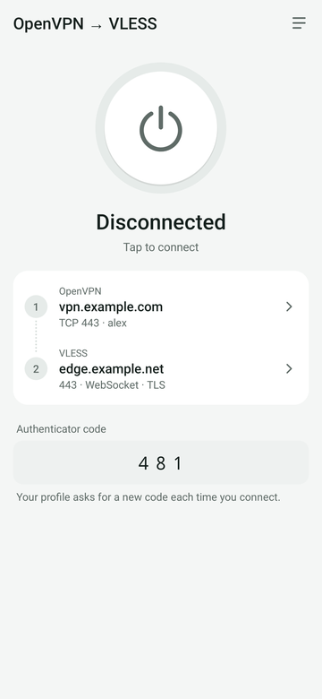
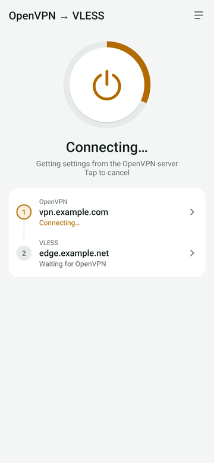
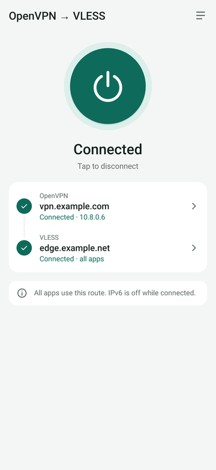
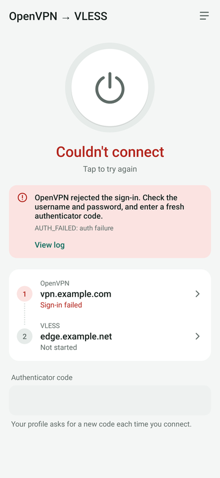
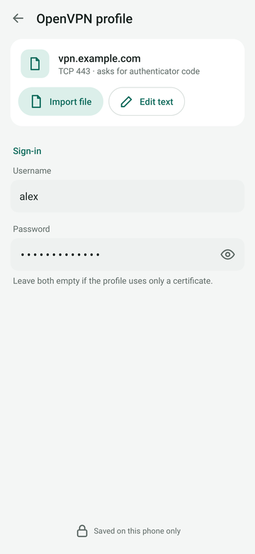
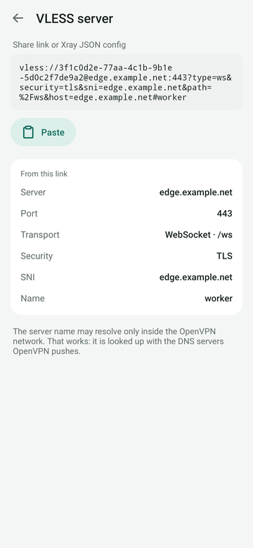
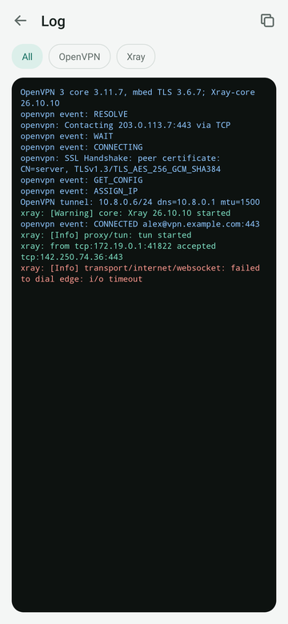
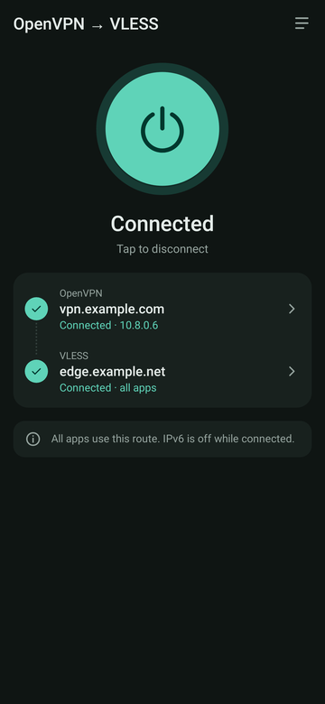

# OpenVPN → VLESS chain for Android

A minimal Android VPN app that first connects to an **OpenVPN** server with the
official **OpenVPN 3 core** library, then connects to a **VLESS** server
*through* that tunnel using **Xray-core** (the v2ray-core fork where VLESS,
REALITY and Vision are developed). It then gives the whole device VPN access
over that chain.

VLESS is optional. With no VLESS server saved, or with **Use VLESS** switched off
on the home screen, the app is a plain OpenVPN client: OpenVPN 3 gets the device
TUN with the addresses, routes and DNS its server pushes.

Several setups can be saved as **profiles** (say Work, Home lab, Travel), each with
its own OpenVPN config, sign-in and VLESS server, and switched from the home screen.

```
apps ─► VpnService TUN ─► Xray "tun" inbound ─► VLESS outbound
                                                   │  (Xray's system dialer replaced)
                                                   ▼
                      userspace TCP/IP stack (gVisor) on a socketpair
                                                   │  raw IP packets
                                                   ▼
                      OpenVPN 3 core ─► UDP/TCP socket ─► OpenVPN server ─► VLESS server ─► internet
```

## Screenshots

| Ready | Connecting | Connected | Couldn't connect |
|:---:|:---:|:---:|:---:|
|  |  |  |  |

| OpenVPN config | VLESS server | Log | Dark theme |
|:---:|:---:|:---:|:---:|
|  |  |  |  |

Rendered with Robolectric on a JVM, not captured on a phone. They predate the
**Use VLESS** switch, which now sits at the end of the VLESS row, and profiles: the
route card now starts with the profile in use, and the OpenVPN screen is called
**OpenVPN config**. [design/profiles-sketches.html](design/profiles-sketches.html) shows
the profile screens.

## Why it is built this way

Android allows one active `VpnService` TUN per app, and the TUN has to carry the
apps' traffic into Xray. So OpenVPN never gets a real TUN:

1. **OpenVPN 3** talks to the OS only through `TunBuilderBase`. When it calls
   `tun_builder_establish()`, `chain::Client` (`app/src/main/cpp/chain_client.hpp`)
   returns one end of an `AF_UNIX` datagram **socketpair**. OpenVPN 3 reads and writes
   raw IP packets on it exactly as it would on a TUN.
2. The other end goes to the **Go engine** (`engine/`), which attaches a gVisor
   TCP/IP stack to it, configured with the IP and DNS the OpenVPN server pushed.
   Xray's system dialer is replaced (`internet.UseAlternativeSystemDialer`), so the
   VLESS connection, and any DNS lookup of the VLESS hostname, is made *inside* the
   OpenVPN tunnel. The Android routing table never points at OpenVPN.
3. Only then does the service build the device TUN (all IPv4, apps' DNS `1.1.1.1`;
   IPv6 is blocked so every app takes the same IPv4 path through VLESS). Xray's
   built-in `tun` inbound reads it, which is the same mechanism v2rayNG uses
   (`xray.tun.fd`).
4. The app excludes itself from its own VPN (`addDisallowedApplication`), so
   OpenVPN's transport socket goes straight to the real network.

Without VLESS (**OpenVPN only**), none of that is needed. `chain::Client` runs in
`Mode::Device`: when OpenVPN 3 calls `tun_builder_establish()`, the service builds
the device TUN from what the server pushed (addresses, routes, DNS servers and search
domains) and returns its file descriptor, which OpenVPN 3 then reads and writes,
as in any OpenVPN app. `redirect-gateway` becomes a `0.0.0.0/0` route; OpenVPN 3
splits routes around excluded ones itself, since Android before 13 can't exclude
routes. Here the app stays inside its own VPN, so its own requests (the IP check, the
update check) go through OpenVPN like other apps'. OpenVPN's transport socket is kept
out of the tunnel with `VpnService.protect()` instead (`socket_protect()`), and its DNS
lookups of the server's hostname use the network under the VPN: the library is linked
with `-Wl,--wrap=getaddrinfo`, and the wrapper calls `android_getaddrinfofornetwork()`
on the Wi-Fi or mobile network (`UnderlyingNetworks`). Without that, OpenVPN 3 would look
the server up again on every reconnect through the VPN's own DNS, inside the tunnel
that is down at that moment.

## What goes through the tunnel

### With VLESS

The app is a full-device VPN: it uses Android's `VpnService` TUN, and everything it
captures is sent to the VLESS server.

* **All IPv4 traffic from other apps.** The TUN routes `0.0.0.0/0`, and Xray's only
  outbound is the VLESS server, with no routing rules. Nothing goes out directly.
* **Apps' DNS.** Apps are given `1.1.1.1` as their DNS server, and those queries go
  over VLESS like any other traffic.
* **Not IPv6.** The TUN has no IPv6 address or route, so Android blocks IPv6 while the
  VPN is up and apps fall back to IPv4.
* **Not this app's own traffic.** The app excludes itself
  (`addDisallowedApplication`), so OpenVPN's connection to its server uses the real
  network instead of looping back into the VPN.

Sniffing is on with `routeOnly: true`: Xray reads the domain from HTTP, TLS and QUIC
for routing, but connects to the original destination IP.

### OpenVPN only

What the OpenVPN server pushes decides it, as with other OpenVPN apps:

* **Routes.** With `redirect-gateway`, all IPv4 traffic goes through OpenVPN.
  Otherwise only the pushed `route`s do, and everything else goes out directly.
* **DNS.** The pushed DNS servers and search domains. If the profile redirects all
  traffic but pushes no DNS server, apps get `8.8.8.8` and `8.8.4.4`, through the
  tunnel.
* **IPv6** follows the same rules if the server sets it up (`ifconfig-ipv6`,
  `route-ipv6`, `redirect-gateway ipv6`). If it sets up no IPv6 at all, Android blocks
  IPv6 while the VPN is up.
* **This app's own traffic too** (the IP check, the update check), except OpenVPN's
  connection to its server and its DNS lookups of the server, as above.

### TUN stack: gVisor

The TUN is read by Xray's built-in `tun` inbound, which turns raw IP packets into TCP
and UDP connections with the **gVisor** userspace TCP/IP stack. That is the only stack
Xray's `tun` inbound has. Its config has no `stack` option, so the `system` and
`mixed` stacks you may know from sing-box don't exist here.

A second gVisor stack runs on the OpenVPN side (`engine/tunnelnet.go`). Xray's dialer
is replaced with it, so the VLESS connection is made inside the OpenVPN tunnel:

```
apps ─► Android TUN ─► Xray tun inbound (gVisor #1) ─► VLESS outbound
     ─► engine's stack (gVisor #2) ─► socketpair ─► OpenVPN 3 ─► real network
```

Neither layer uses the kernel's TCP/IP stack for tunnelled traffic. Both run in
userspace inside the app's process.

## Libraries used

| Need | Library | Version |
|---|---|---|
| OpenVPN client | [OpenVPN 3 core](https://github.com/OpenVPN/openvpn3) (official, OpenVPN Inc.) | `release/3.11.7` + one backported fix |
| TLS for OpenVPN 3 | [mbed TLS](https://github.com/Mbed-TLS/mbedtls) | 3.6.7 (LTS) |
| OpenVPN 3 deps | asio (with openvpn3's patches), lz4, fmt | asio-1-24-0, 1.10.0, 12.2.0 |
| VLESS client | [Xray-core](https://github.com/XTLS/Xray-core) | v26.10.10 (same commit as the official [AndroidLibXrayLite](https://github.com/2dust/AndroidLibXrayLite)) |
| Userspace TCP/IP | gVisor netstack (Xray-core's pinned version) | |
| Go → Android | gomobile | |

Notes on the choices:

* **"openconnect3" vs OpenVPN 3.** *OpenConnect* is a different VPN protocol (Cisco
  AnyConnect / ocserv) and can't talk to an OpenVPN server. This app uses **OpenVPN 3**,
  the official client library behind OpenVPN Connect and the OpenVPN 3 Linux client.
  If you actually need OpenConnect, the same socketpair design works with libopenconnect,
  but the native side would have to be replaced.
* **Xray-core vs v2fly/v2ray-core.** v2fly v5 only has basic VLESS: no REALITY, no
  `xtls-rprx-vision`, no XHTTP. Most VLESS servers today use those, so the engine
  embeds Xray-core, as v2rayNG does. Its config format is the familiar v2ray JSON.
* **mbed TLS instead of OpenSSL** keeps the NDK build to plain CMake. The release tag
  needs one fix to work with mbed TLS ≥ 3.6.3; it is backported from openvpn3 master
  in `app/src/main/cpp/patches/`.

## Layout

```
app/                      Android app (Kotlin, no AndroidX)
  src/main/cpp/           OpenVPN 3 JNI library (CMake, fetches deps at configure time)
    chain_client.hpp      OpenVPN 3 client with socketpair or device TUN (JNI-free)
    ovpn3_jni.cpp         JNI bridge to io.github.meshkati.ovpnvless.OpenVpn3, and the
                          getaddrinfo wrapper for OpenVPN-only sessions
  src/main/java/.../      ChainVpnService, OpenVpn3, UnderlyingNetworks, VpnState,
                          IpCheck, Settings, Profiles, and the UI:
                          MainActivity (home), ProfilePicker, ProfilesActivity,
                          ProfileActivity, OpenVpnActivity, ProfileTextActivity,
                          VlessActivity, LogActivity, DonateActivity, and the
                          home-screen widgets (Widgets, WidgetState)
  src/test/               JVM unit tests for the config/link summaries, status text and profiles
design/                   UI sketches and screenshots
engine/                   Go: Xray-core + gVisor stack, gomobile API, vless:// parser
scripts/build-engine.sh   gomobile bind → app/libs/engine.aar
hosttest/                 Linux end-to-end tests of both routes (no Android needed)
```

## Building

Requirements: Android SDK with NDK and CMake 3.22.1 (Android Studio's SDK Manager),
JDK 17+, Go ≥ 1.27, git (CMake clones the native dependencies). The NDK version is
pinned in `gradle.properties` (`ndkVersion`); CI builds with the same one.

```sh
export ANDROID_HOME=~/Android/Sdk          # and ANDROID_NDK_HOME if needed
scripts/build-engine.sh                     # builds app/libs/engine.aar
./gradlew :app:assembleDebug                # builds the APK, including the OpenVPN 3 .so
adb install app/build/outputs/apk/debug/app-debug.apk
```

### macOS, step by step

```sh
# Tools (Homebrew)
xcode-select --install 2>/dev/null || true          # git
brew install openjdk@17 go
brew install --cask android-commandlinetools
export JAVA_HOME="$(brew --prefix openjdk@17)/libexec/openjdk.jdk/Contents/Home"
export ANDROID_HOME="$HOME/Library/Android/sdk"

# Android SDK packages, with the NDK pinned in gradle.properties
yes | sdkmanager --sdk_root="$ANDROID_HOME" --licenses >/dev/null
NDK_VER=30.0.16248370
sdkmanager --sdk_root="$ANDROID_HOME" "platform-tools" "platforms;android-36" "cmake;3.22.1" "ndk;$NDK_VER"
export ANDROID_NDK_HOME="$ANDROID_HOME/ndk/$NDK_VER"
export PATH="$ANDROID_HOME/platform-tools:$PATH"

# Build
git clone -b main https://github.com/Meshkati/android-openvpn-socks.git
cd android-openvpn-socks
echo "sdk.dir=$ANDROID_HOME" > local.properties
scripts/build-engine.sh
./gradlew :app:assembleDebug

# Install: enable Developer options + USB debugging on the phone, plug it in,
# accept the "Allow USB debugging" prompt, then:
adb devices
adb install -r app/build/outputs/apk/debug/app-debug.apk
```

For day-to-day work, plain `./gradlew installDebug` builds and installs on
every connected device (USB or wireless debugging). `app/libs/engine.aar` is not built
by Gradle: re-run `scripts/build-engine.sh` after changing `engine/`. It needs Go 1.27;
with an older Go installed, `GOTOOLCHAIN=go1.27.2 scripts/build-engine.sh` works.

Behind a filtered network where `dl.google.com` fails, `sdkmanager` takes
`--proxy=http --proxy_host=… --proxy_port=…`, and Gradle reads
`systemProp.https.proxyHost`/`proxyPort` from `~/.gradle/gradle.properties`.

### CI

`.github/workflows/ci.yml` has two jobs:

* **Engine (Go)**: `go vet` and `go test` on `engine/`, on every pull request and every
  push to `main`.
* **Android app**: builds `engine.aar`, runs the JVM unit tests and builds the debug
  APK. It runs on every push to `main`. For any other branch it is manual, so it never
  holds up a pull request: Actions → CI → Run workflow, then pick the branch.

The debug APK is attached to the run as an artifact (kept 14 days), so a branch can be
installed with `adb install -r app-debug.apk` without building it locally. The
end-to-end tests in `hosttest/` need root and are not run in CI yet.

### Releases

Signed APKs are published on the
[Releases](https://github.com/Meshkati/android-openvpn-socks/releases) page by
`.github/workflows/release.yml`. To make a release, tag `main`:

```sh
git checkout main && git pull
git tag v0.2.0 && git push origin v0.2.0
```

The tag must be `vMAJOR.MINOR.PATCH` (each 0–99). It sets `versionName` to
`MAJOR.MINOR.PATCH` and `versionCode` to `MAJOR*10000 + MINOR*100 + PATCH`, so each
release installs over the previous one. The Release gets the APK, a `SHA256SUMS` file
and notes generated from the merged pull requests.

The APK is signed with the release key from the repository's Actions secrets
(`KEYSTORE_BASE64`, `KEYSTORE_PASSWORD`, `KEY_ALIAS`, `KEY_PASSWORD`). A pull request
that changes `release.yml` builds and signs the APK the same way, without publishing it.

Debug builds are signed with a different key, so they use their own app id,
`io.github.meshkati.ovpnvless.debug`, and show up as "OpenVPN → VLESS (debug)". A
release and `./gradlew installDebug` can be installed side by side, each with its own
settings. Android runs one VPN at a time, so connecting one disconnects the other.

## Using the app

See [Screenshots](#screenshots) for every screen. The home screen has one round button that connects and disconnects, the status in
plain words, and your route: the profile in use, then OpenVPN, then VLESS. Tap a step of
the route to set it up for that profile; tap the profile to switch (see [Profiles](#profiles)).

1. **OpenVPN config**: tap **Import file**, or **Edit text** to paste the `.ovpn`.
   Inline `<ca>`, `<cert>`, `<key>`, `<tls-auth>`, `<tls-crypt>` and `<tls-crypt-v2>`
   work. A username/password-only config (no client cert) also works. Enter the
   username and password if the config has `auth-user-pass`.
2. **Authenticator code**: if the config has `static-challenge` (e.g. OpenVPN Access
   Server with an authenticator app), the home screen shows a code field. Enter the
   current code before each connect. It is never stored.
3. **VLESS server** (optional): paste a share link, for example
   `vless://UUID@host:443?security=reality&sni=…&pbk=…&sid=…&fp=chrome&type=tcp&flow=xtls-rprx-vision`.
   Supported: `type=tcp|ws|grpc|httpupgrade|xhttp`, `security=none|tls|reality`.
   You can also paste a full Xray JSON config instead; it must contain a `tun` inbound.
   The VLESS host may be a name that only resolves inside the OpenVPN network. It is
   resolved with the DNS servers OpenVPN pushes. The screen shows what it read from the
   link (server, port, transport, security) so you can check it.
   A TLS link with `fp=randomized` or `fp=randomizednoalpn` gets a warning, here and on
   the home screen, with a button that changes it to `fp=chrome`. Those fingerprints can
   offer post-quantum TLS (X25519MLKEM768) without sending a key for it. A server that
   wants it, like Cloudflare's, then asks again, which uTLS can't answer: every
   connection fails with `tls: CurvePreferences includes unsupported curve`. Xray picks
   the random fingerprint once per app run, so this comes and goes. **Keep** hides the
   home-screen warning until the link changes.
   Once a VLESS server is saved, its row on the home screen has a **Use VLESS** switch.
   Turn it off to connect with OpenVPN only and keep the VLESS setting for later. The
   switch can be changed while disconnected, and the caption above the route says
   which route the next connect uses.
4. Tap the round button and accept the VPN prompt. If connecting fails, the home screen
   says why and which step failed. The log (top-right icon) shows the OpenVPN 3 and Xray
   output, and can be filtered and copied.
5. **Check IP**: the home screen's **Public IP** card asks `https://ifconfig.me/ip` and
   shows the address it sees, with the full log of the request under it. The same lines
   go to the log screen as `ip check: …`. It goes the way apps' traffic goes at that
   moment, and the card says which:
   * **VPN off**: straight over the network, so it shows your real IP.
   * **OpenVPN only**: the app is inside its own VPN in this mode, so a plain request
     goes through OpenVPN like any app's.
   * **Through VLESS**: the app is excluded from its own VPN, so the request doesn't use
     the device TUN. The Go engine sends it into Xray's routing (`core.Dial`), the way
     apps' traffic leaves, and the VLESS server looks up `ifconfig.me`. The log also
     shows the stream opened through Xray, the TLS handshake and certificate, and any
     Xray lines logged meanwhile.

   While connecting or disconnecting the button waits. The result is cleared when a
   connection starts or ends, so an old IP is never shown for the new state.

The UI follows the system light/dark setting.

### Profiles

A profile is a whole route saved under a name: the OpenVPN config with its username and
password, and optionally a VLESS server with its **Use VLESS** switch. The first start
after updating turns the setup you had into the first profile, named after its OpenVPN
server, so nothing has to be entered again.

* **Switch**: tap the profile at the top of the home screen's route card. A sheet lists
  every profile with its route (`vpn.example.com → edge.example.net`, or `· OpenVPN only`).
  Tap one to use it. While connected, picking another one disconnects and connects with
  it; if it asks for an authenticator code, it only disconnects and the home screen asks
  for the code.
* **New profile** (in the sheet, or on the Profiles screen) starts empty. The name is
  optional: without one the profile is named after its OpenVPN server. A new profile left
  empty is not kept.
* **Manage profiles** opens the list. Tap a profile to edit its name and route without
  switching to it, or to **Use this profile**. Its menu has **Rename**, **Duplicate**
  (a copy named "Travel NL 2", the quickest way to try another VLESS server with the same
  OpenVPN), **Move up**/**Move down** (the sheet uses the same order) and **Delete**,
  which can be undone for a few seconds. The only profile can't be deleted, nor the one in
  use while connected.
* With more than one profile, the notification, the 4×2 widget and the OpenVPN and VLESS
  screens also name the profile. The widgets always connect the profile in use.
* Crash reports hide the servers, UUIDs and usernames of every profile, not just the one
  in use.

### Widgets

Two home-screen widgets connect and disconnect without opening the app. Long-press the
home screen, tap **Widgets**, and pick **VPN on/off** or **VPN route**.

* **VPN on/off** (1×1) is just the round button. Filled green means connected through
  OpenVPN *and* VLESS; a green outline means connected with OpenVPN only; orange spins
  while connecting; red means the last try failed. Under the button, one dot for
  OpenVPN and one for VLESS, joined by a line that turns solid green once both are
  connected.
* **VPN route** (4×2, can be made 3 wide) has the button, and both steps of the route as
  on the home screen: server, then status (`Connected · 10.8.0.6`, `Waiting for OpenVPN`,
  `Couldn't start`, …). The line between the steps turns solid green once both are
  connected. After a **Check IP** on the home screen, the VLESS step shows **IP ✓**
  (or **IP ✗**). With more than one profile, the profile in use is named under the
  button. Tapping anywhere but the button opens the app.

The button opens the app instead of connecting when the app has to ask something
first: the VPN permission, the authenticator code (the lock icon), or an OpenVPN config
when none is set up. The widgets are redrawn when the connection changes, so they don't
wake the phone on a timer.

### Donate

The coffee icon on the home screen opens **Buy me a coffee**: **A coffee** ($2.99),
**A lunch** ($9.99), or any amount from $1 to $10,000. Each opens
`https://paypal.me/meshkati/<amount>USD` in the browser, where PayPal asks to confirm
the payment. The app makes no request itself and stores nothing about it.

### About

The info icon on the home screen opens **About**: the app version and the versions of
the two cores built into it, **Xray-core** (e.g. `26.10.10`) and **OpenVPN 3 core**
(e.g. `3.11.7`). The copy icon puts all three on the clipboard, for a bug report, and
**Source code on GitHub** opens this repository. The log also names the core versions
at the start of each connection (Xray-core's only when the connection uses VLESS).

### Updates

The app is not on Google Play; new versions are on the
[Releases](https://github.com/Meshkati/android-openvpn-socks/releases) page. When the
home screen opens, the app asks GitHub for the latest release, at most once a day (an
hour after a failed try). If it is newer than the installed version, the home screen
shows a notice: **Download** opens the release page in the browser, **Later** hides
the notice until a newer release comes out. Open the downloaded APK to install it over
the old one; the settings stay.

To check now, tap **Check for updates** under the version on the About screen. It
reports whether a newer release is out (even one you tapped **Later** on, and then the
button opens its release page), that you have the latest version, or that GitHub could
not be reached. A check that works there counts as the day's check, so the home screen
shows its notice too.

* The app only reads `api.github.com/repos/Meshkati/android-openvpn-socks/releases/latest`
  over HTTPS. The request carries no account, device or settings, only a
  `User-Agent: ovpnvless/<version> (Android)` header, which GitHub requires. GitHub sees
  the phone's IP address. With VLESS the app is excluded from its own VPN, so this
  request goes over the normal network, connected or not. With OpenVPN only it goes
  through OpenVPN while connected.
* It never downloads or installs anything itself. The link it opens is built from the
  version number, so it always points at this repository. Android installs an update
  only if it is signed with the same key as the installed app, so an APK from
  somewhere else cannot replace it. To check a download by hand, compare its SHA-256
  with the `SHA256SUMS` file in the release.
* Only release builds (a `versionName` from a tag, like `0.2.0`) check on their own.
  Debug and local builds never do; **Check for updates** there only names the latest
  release.

### Crash reports

The app has no analytics or crash-reporting service and sends nothing on its own. If
it crashed, the next time the home screen opens it says so, with **Report**, **Share**
and **Dismiss**:

* **Report** opens a new GitHub issue in the browser with the report filled in. The
  user reads it and decides whether to submit it. A long report is cut to fit the link.
* **Share** sends the full report with any app (Telegram, email, copy).
* **Dismiss** deletes it.

What it records, in app-private files, and only for the installed version:

* **Kotlin/Java crashes**: the stack trace, from an uncaught-exception handler.
* **Go crashes** (Xray, gVisor): the panic and goroutine stacks, which the Go runtime
  writes to a file (`engine.SetCrashFile`, using `debug.SetCrashOutput`).
* **Native crashes** (OpenVPN 3, mbed TLS, or a signal in the engine) and **ANRs**:
  Android's own record of why the process died (`ApplicationExitInfo`, Android 11+).
  From Android 12 that includes the tombstone; the app takes only the signal, abort
  message and the crashing thread's backtrace. The tombstone also holds the app's
  logcat, registers and memory; those are skipped. For an ANR, the main thread's stack.

The report adds the app version, Android version and ABI, the phone model and which
route was set (OpenVPN only or with VLESS). Before it is shown, the OpenVPN servers
(every `remote`), the VLESS server and UUID, server addresses in a VLESS JSON config,
the username, and any other UUID or IPv4 address are replaced with `[server]`, `[uuid]`
and `[ip]`. An error message can still name something unexpected, so the user sees the
text before sending it. The app log is never included.

Why not Sentry or similar: with VLESS the app is excluded from its own VPN, so a crash
upload would go over the normal network. The service, and anyone watching the network, would
learn the user's real IP and that they use this app.

## Testing

* `cd engine && go test ./...` checks that Xray-core accepts every config the
  `vless://` parser produces, and runs the IP check through a real Xray instance
  against a local HTTPS server (answer, log, bad answers, untrusted certificate).
  It also checks that a Go panic lands in the crash file. The engine builds on Linux
  only (gVisor).
* `./gradlew :app:testDebugUnitTest` runs the app's JVM unit tests: the OpenVPN config and
  `vless://` summaries the UI shows, the profile list (order, delete and undo, which profile
  is in use) and profile names, the mapping from OpenVPN events and errors
  to status text, the choice between the two routes, how the IP check goes in each state and
  what counts as an IP in its answer, what the widgets show in each state, the version comparison and
  timing of the update check, the donation amounts, and the crash report (reading a tombstone, hiding
  servers and addresses, cutting the GitHub link to size).
* `sudo hosttest/run-e2e.sh` (Linux, needs `openvpn dnsmasq openssl python3 go cmake ninja`)
  runs the full chain on a PC. It starts an OpenVPN 2.6 server (user/pass + tls-crypt),
  a DNS server reachable only inside the tunnel, and an Xray **VLESS + REALITY + Vision**
  server that listens only on the tunnel address. It then runs the real `chain::Client`
  (OpenVPN 3 core) and the Go engine, and downloads files through SOCKS → VLESS → OpenVPN.
  It also checks that the VLESS server saw the client at its OpenVPN address.
* `sudo hosttest/run-device-tun.sh` (Linux, needs `openvpn iproute2 openssl python3 curl
  cmake ninja`) tests the OpenVPN-only route. It starts an OpenVPN 2.6 server
  (client certificate only) in a network namespace that pushes a route, a DNS server
  and a search domain, and an HTTP server reachable only through the tunnel. It runs
  `chain::Client` in `Mode::Device` with a real Linux TUN, set up from the pushed
  settings as the app does on Android. It then pings the server's tunnel address and
  fetches a file through the TUN.

## Status and limitations

What was verified while writing this, on Linux x86_64:

* `run-e2e.sh` passes. An 8 MB download arrives byte-identical through the real
  OpenVPN 3 core → socketpair → gVisor → Xray VLESS/REALITY/Vision chain.
* `run-device-tun.sh` passes: in `Mode::Device` OpenVPN 3 reads and writes a real TUN
  that was configured from the pushed route, DNS server and search domain.
* The JNI library builds and links against the JDK. A JVM run under `-Xcheck:jni`
  driving the real OpenVPN 3 session works, using the compiled Kotlin `OpenVpn3`
  class: connect, `onTun`, stop from another thread, clean return.
* The Kotlin sources compile with `-Werror` against the Android 16 (API 36) framework.
* The Go engine cross-compiles for android/arm64, arm and amd64.

Verified on a phone (Pixel 10 Pro, Android 16; built on macOS with AGP 8.13, NDK r30,
Go 1.27.2): an OpenVPN Access Server profile (TCP, `tls-crypt-v2`, authenticator
code) connects with TLS 1.3, and a VLESS link (WebSocket + TLS via a Cloudflare Worker)
carries all traffic. whatismyip.com in Chrome shows the VLESS exit for IPv4 and
"IPv6: not detected". The OpenVPN-only route has not been tried on a phone yet.

### Fixed after the first run on a phone

* **Engine link error with Go ≥ 1.23.** `gomobile bind` failed with `link:
  github.com/wlynxg/anet: invalid reference to net.zoneCache`. anet (pulled in by
  Xray-core through pion/stun) uses `//go:linkname` into `net`, so
  `scripts/build-engine.sh` now links with `-checklinkname=0`, as anet documents.
* **`ERR_INVALID_OPTION_CRYPTO: tls-version-min: unrecognized TLS version`.** OpenVPN
  Access Server profiles contain `tls-version-min 1.3`. OpenVPN 3's mbed TLS backend
  caps that option at 1.2 when parsing (`mbedtls/ssl/sslctx.hpp`, also on openvpn3
  master) and throws before connecting. `chain::Client` rewrites the line to
  `tls-version-min 1.3 or-highest`, which only lowers the minimum: mbed TLS 3.6 still
  negotiates TLS 1.3 with servers that offer it.
* **Authenticator codes (`static-challenge`).** The app has a one-time code field. The
  code goes to OpenVPN 3 as `ProvideCreds.response` (sent as
  `SCRV1:<password>:<code>`), is never stored, and is cleared after each Connect.
  Without a code, a profile with `static-challenge` stops before contacting the server.
* **Sites saw a different exit IP than the VLESS one (IPv6).** The device TUN offered
  IPv6, so browsers preferred IPv6. Those connections still went through VLESS (the app
  has no other route out), but a Cloudflare Worker sends IPv6 destinations out through
  a different relay than IPv4 ones, so whatismyip showed an unexpected address. The
  OpenVPN server also pushes `block-ipv6`. The TUN is now IPv4-only: with no IPv6
  address or route, Android blocks IPv6 while the VPN is up (no leak to Wi-Fi) and apps
  fall back to IPv4.
* **Crash when the app went to the background** (`TransactionTooLargeException`, about
  1 MB). The profile `EditText` kept its text and undo history in the saved instance
  state. The profile, VLESS and log views no longer save view state. Their content
  already lives in `Settings` and `VpnState`.

Limitations of this minimal version:

* No OpenVPN dynamic challenge (`CRV1`), private-key passphrase, or external PKI.
  Static challenge (`static-challenge`, e.g. authenticator codes) works, but the code
  must be typed for each Connect, so always-on VPN cannot start such a profile.
* With VLESS, IPv6 is blocked while connected. Everything goes over IPv4 through VLESS.
* Credentials are stored unencrypted in app-private SharedPreferences, one file per profile.
* With VLESS, apps' DNS is fixed to `1.1.1.1` (carried over VLESS). There are no routing
  rules or per-app selection; everything except this app goes through the chain.
* With VLESS, OpenVPN `route`/`redirect-gateway` options are ignored. Only Xray uses the
  OpenVPN tunnel, so routes have no effect. OpenVPN only follows them.

## To do: leak checks

The IPv6 case showed that "it connects" is not proof that every packet goes through
VLESS. Check these before relying on the app:

- [ ] **The app's own sockets.** The app is excluded from its own VPN, and the Go
  engine runs in its process, so any socket there that bypasses Xray's tunnel dialer
  goes straight to Wi-Fi. While connected, the only kernel socket owned by the app's
  UID should be the one to the OpenVPN server. Check with
  `adb shell 'cat /proc/net/tcp /proc/net/tcp6 /proc/net/udp /proc/net/udp6'` filtered
  by the app's UID (column 8), over time and across connect/reconnect, not as a single
  snapshot. One snapshot on the Pixel showed only the OpenVPN connection.
- [ ] **VLESS hostname lookup without pushed DNS.** `engine/tunnelnet.go` falls back to
  `net.DefaultResolver` when OpenVPN pushes no DNS servers. In this process that
  resolver uses Wi-Fi, so the VLESS hostname would be resolved outside the tunnel.
  Refuse to start, or use a fixed resolver inside the tunnel.
- [ ] **DNS leaks.** Apps use `1.1.1.1` through VLESS. Confirm with dnsleaktest.com or
  browserleaks.com/dns that no ISP or OpenVPN-network resolver sees the queries, also
  with Android Private DNS on and with Chrome's Secure DNS.
- [ ] **UDP, QUIC and WebRTC.** UDP is routed to VLESS too, but a Cloudflare Worker
  can't carry UDP (except DNS), and other servers may send UDP out somewhere else.
  Check browserleaks.com/webrtc for public candidates, and compare exit IPs over
  HTTP/3 and over TCP.
- [ ] **Pasted Xray JSON configs.** A user config with a `freedom`/direct outbound
  exits through the OpenVPN network (the system dialer is replaced). A `dns` section
  with `localhost` uses Go's resolver, which goes to Wi-Fi from this process. Warn about
  or reject these.
- [ ] **Kill switch.** If OpenVPN drops for good or the app crashes, the VPN goes away
  and apps use Wi-Fi directly. Test with Android's Always-on VPN + "Block connections
  without VPN", and decide how that works with authenticator codes.
- [ ] **Reconnects and network changes.** Check Wi-Fi ↔ mobile switches and OpenVPN
  `ping-restart`: `onTun` rebuilds the TUN and restarts the engine, so look for windows
  where traffic is not carried, and check that nothing falls back to the real network.
- [ ] **OpenVPN only on a phone.** Try a `redirect-gateway` profile and a split one
  (only `route`s): apps outside the routes should use Wi-Fi directly, the pushed DNS
  should be used, IPv6 should be blocked when the server sets up none, and a
  reconnect (Wi-Fi ↔ mobile, `ping-restart`) should keep the TUN.
- [ ] **Profiles on a phone.** Update over an older version and check the setup comes
  back as the first profile, password included. Switch profiles while connected: the
  session should restart with the new one, and nothing should leave outside the VPN
  between the two sessions (with and without "Block connections without VPN"). Check the
  picker sheet over the navigation bar on Android 15+ with gesture and 3-button navigation.
- [ ] **Exit IP consistency.** Check several IP services (TCP and HTTP/3), plus
  whatismyip.com showing "IPv6: not detected", after OS updates and with other VLESS
  servers, not only the Worker.

## Licenses

OpenVPN 3 core: AGPLv3 or MPL-2.0. Xray-core: MPL-2.0. gVisor: Apache-2.0.
mbed TLS: Apache-2.0 or GPL-2.0-or-later. Check that your distribution complies with them.
