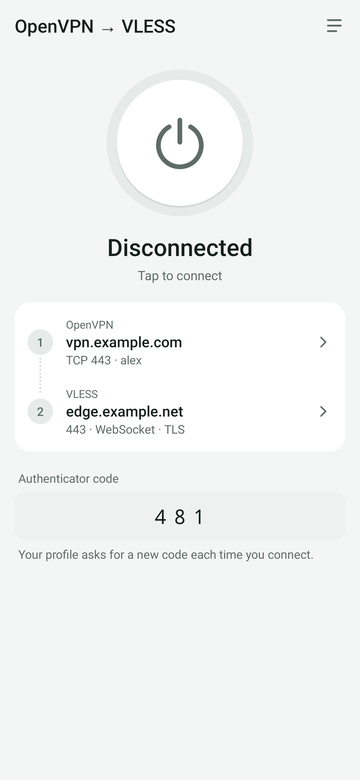
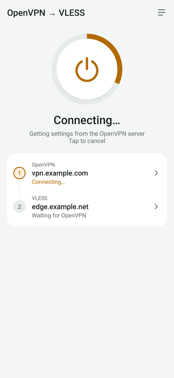
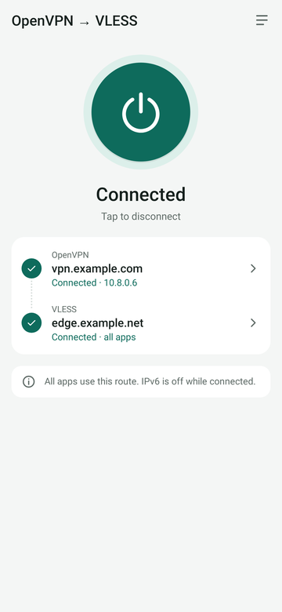
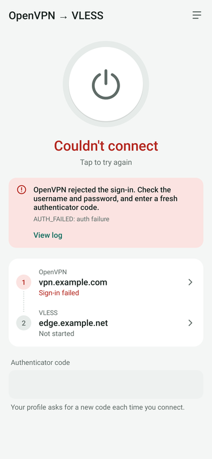
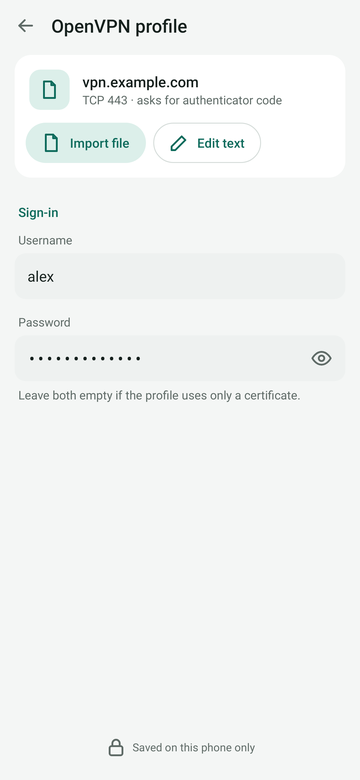
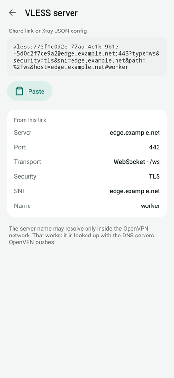
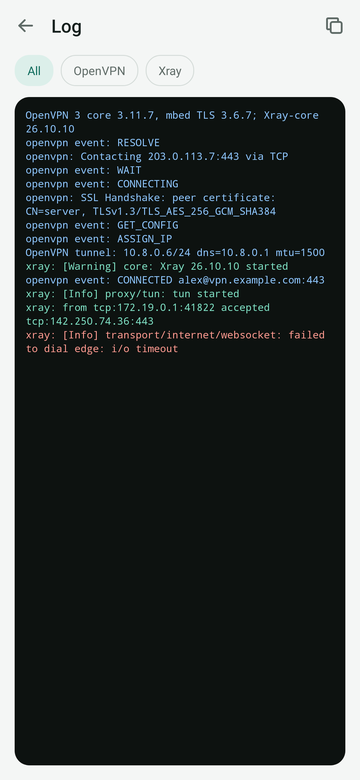
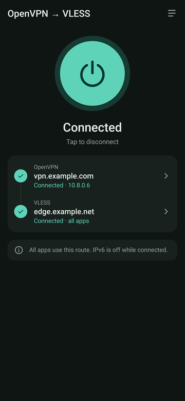

# OpenVPN → VLESS chain for Android

A minimal Android VPN app that first connects to an **OpenVPN** server with the
official **OpenVPN 3 core** library, then connects to a **VLESS** server
*through* that tunnel using **Xray-core** (the v2ray-core fork where VLESS,
REALITY and Vision are developed). It then gives the whole device VPN access
over that chain.

```
apps ─► VpnService TUN ─► Xray "tun" inbound ─► VLESS outbound
                                                   │  (Xray's system dialer replaced)
                                                   ▼
                      userspace TCP/IP stack (gVisor) on a socketpair
                                                   │  raw IP packets
                                                   ▼
                      OpenVPN 3 core ─► UDP/TCP socket ─► OpenVPN server ─► VLESS server ─► internet
```

## Screenshots

| Ready | Connecting | Connected | Couldn't connect |
|:---:|:---:|:---:|:---:|
|  |  |  |  |

| OpenVPN profile | VLESS server | Log | Dark theme |
|:---:|:---:|:---:|:---:|
|  |  |  |  |

Rendered with Robolectric on a JVM, not captured on a phone.

## Why it is built this way

Android allows one active `VpnService` TUN per app, and the TUN has to carry the
apps' traffic into Xray. So OpenVPN never gets a real TUN:

1. **OpenVPN 3** talks to the OS only through `TunBuilderBase`. When it calls
   `tun_builder_establish()`, `chain::Client` (`app/src/main/cpp/chain_client.hpp`)
   returns one end of an `AF_UNIX` datagram **socketpair**. OpenVPN 3 reads and writes
   raw IP packets on it exactly as it would on a TUN.
2. The other end goes to the **Go engine** (`engine/`), which attaches a gVisor
   TCP/IP stack to it, configured with the IP and DNS the OpenVPN server pushed.
   Xray's system dialer is replaced (`internet.UseAlternativeSystemDialer`), so the
   VLESS connection, and any DNS lookup of the VLESS hostname, is made *inside* the
   OpenVPN tunnel. The Android routing table never points at OpenVPN.
3. Only then does the service build the device TUN (all IPv4, apps' DNS `1.1.1.1`;
   IPv6 is blocked so every app takes the same IPv4 path through VLESS). Xray's
   built-in `tun` inbound reads it, which is the same mechanism v2rayNG uses
   (`xray.tun.fd`).
4. The app excludes itself from its own VPN (`addDisallowedApplication`), so
   OpenVPN's transport socket goes straight to the real network.

## What goes through the tunnel

The app is a full-device VPN: it uses Android's `VpnService` TUN, and everything it
captures is sent to the VLESS server.

* **All IPv4 traffic from other apps.** The TUN routes `0.0.0.0/0`, and Xray's only
  outbound is the VLESS server, with no routing rules. Nothing goes out directly.
* **Apps' DNS.** Apps are given `1.1.1.1` as their DNS server, and those queries go
  over VLESS like any other traffic.
* **Not IPv6.** The TUN has no IPv6 address or route, so Android blocks IPv6 while the
  VPN is up and apps fall back to IPv4.
* **Not this app's own traffic.** The app excludes itself
  (`addDisallowedApplication`), so OpenVPN's connection to its server uses the real
  network instead of looping back into the VPN.

Sniffing is on with `routeOnly: true`: Xray reads the domain from HTTP, TLS and QUIC
for routing, but connects to the original destination IP.

### TUN stack: gVisor

The TUN is read by Xray's built-in `tun` inbound, which turns raw IP packets into TCP
and UDP connections with the **gVisor** userspace TCP/IP stack. That is the only stack
Xray's `tun` inbound has. Its config has no `stack` option, so the `system` and
`mixed` stacks you may know from sing-box don't exist here.

A second gVisor stack runs on the OpenVPN side (`engine/tunnelnet.go`). Xray's dialer
is replaced with it, so the VLESS connection is made inside the OpenVPN tunnel:

```
apps ─► Android TUN ─► Xray tun inbound (gVisor #1) ─► VLESS outbound
     ─► engine's stack (gVisor #2) ─► socketpair ─► OpenVPN 3 ─► real network
```

Neither layer uses the kernel's TCP/IP stack for tunnelled traffic. Both run in
userspace inside the app's process.

## Libraries used

| Need | Library | Version |
|---|---|---|
| OpenVPN client | [OpenVPN 3 core](https://github.com/OpenVPN/openvpn3) (official, OpenVPN Inc.) | `release/3.11.7` + one backported fix |
| TLS for OpenVPN 3 | [mbed TLS](https://github.com/Mbed-TLS/mbedtls) | 3.6.7 (LTS) |
| OpenVPN 3 deps | asio (with openvpn3's patches), lz4, fmt | asio-1-24-0, 1.10.0, 12.2.0 |
| VLESS client | [Xray-core](https://github.com/XTLS/Xray-core) | v26.10.10 (same commit as the official [AndroidLibXrayLite](https://github.com/2dust/AndroidLibXrayLite)) |
| Userspace TCP/IP | gVisor netstack (Xray-core's pinned version) | |
| Go → Android | gomobile | |

Notes on the choices:

* **"openconnect3" vs OpenVPN 3.** *OpenConnect* is a different VPN protocol (Cisco
  AnyConnect / ocserv) and can't talk to an OpenVPN server. This app uses **OpenVPN 3**,
  the official client library behind OpenVPN Connect and the OpenVPN 3 Linux client.
  If you actually need OpenConnect, the same socketpair design works with libopenconnect,
  but the native side would have to be replaced.
* **Xray-core vs v2fly/v2ray-core.** v2fly v5 only has basic VLESS: no REALITY, no
  `xtls-rprx-vision`, no XHTTP. Most VLESS servers today use those, so the engine
  embeds Xray-core, as v2rayNG does. Its config format is the familiar v2ray JSON.
* **mbed TLS instead of OpenSSL** keeps the NDK build to plain CMake. The release tag
  needs one fix to work with mbed TLS ≥ 3.6.3; it is backported from openvpn3 master
  in `app/src/main/cpp/patches/`.

## Layout

```
app/                      Android app (Kotlin, no AndroidX)
  src/main/cpp/           OpenVPN 3 JNI library (CMake, fetches deps at configure time)
    chain_client.hpp      OpenVPN 3 client with socketpair "tun" (JNI-free)
    ovpn3_jni.cpp         JNI bridge to io.github.meshkati.ovpnvless.OpenVpn3
  src/main/java/.../      ChainVpnService, OpenVpn3, VpnState, Settings, and the UI:
                          MainActivity (home), OpenVpnActivity, ProfileTextActivity,
                          VlessActivity, LogActivity
  src/test/               JVM unit tests for the profile/link summaries and status text
design/                   UI sketches and screenshots
engine/                   Go: Xray-core + gVisor stack, gomobile API, vless:// parser
scripts/build-engine.sh   gomobile bind → app/libs/engine.aar
hosttest/                 Linux end-to-end test of the whole chain (no Android needed)
```

## Building

Requirements: Android SDK with NDK and CMake 3.22.1 (Android Studio's SDK Manager),
JDK 17+, Go ≥ 1.27, git (CMake clones the native dependencies).

```sh
export ANDROID_HOME=~/Android/Sdk          # and ANDROID_NDK_HOME if needed
scripts/build-engine.sh                     # builds app/libs/engine.aar
./gradlew :app:assembleDebug                # builds the APK, including the OpenVPN 3 .so
adb install app/build/outputs/apk/debug/app-debug.apk
```

### macOS, step by step

```sh
# Tools (Homebrew)
xcode-select --install 2>/dev/null || true          # git
brew install openjdk@17 go
brew install --cask android-commandlinetools
export JAVA_HOME="$(brew --prefix openjdk@17)/libexec/openjdk.jdk/Contents/Home"
export ANDROID_HOME="$HOME/Library/Android/sdk"

# Android SDK packages, with the newest stable NDK
yes | sdkmanager --sdk_root="$ANDROID_HOME" --licenses >/dev/null
NDK_VER=$(sdkmanager --sdk_root="$ANDROID_HOME" --list 2>/dev/null \
  | grep -oE 'ndk;[0-9]+\.[0-9]+\.[0-9]+ ' | sed 's/ndk;//; s/ //' | sort -V | tail -1)
sdkmanager --sdk_root="$ANDROID_HOME" "platform-tools" "platforms;android-36" "cmake;3.22.1" "ndk;$NDK_VER"
export ANDROID_NDK_HOME="$ANDROID_HOME/ndk/$NDK_VER"
export PATH="$ANDROID_HOME/platform-tools:$PATH"

# Build
git clone -b main https://github.com/Meshkati/android-openvpn-socks.git
cd android-openvpn-socks
echo "sdk.dir=$ANDROID_HOME" > local.properties
scripts/build-engine.sh
./gradlew :app:assembleDebug -PndkVersion="$NDK_VER"

# Install: enable Developer options + USB debugging on the phone, plug it in,
# accept the "Allow USB debugging" prompt, then:
adb devices
adb install -r app/build/outputs/apk/debug/app-debug.apk
```

For day-to-day work, put the NDK version in `~/.gradle/gradle.properties` once
(`ndkVersion=30.0.16248370`), and plain `./gradlew installDebug` builds and installs on
every connected device (USB or wireless debugging). `app/libs/engine.aar` is not built
by Gradle: re-run `scripts/build-engine.sh` after changing `engine/`. It needs Go 1.27;
with an older Go installed, `GOTOOLCHAIN=go1.27.2 scripts/build-engine.sh` works.

Behind a filtered network where `dl.google.com` fails, `sdkmanager` takes
`--proxy=http --proxy_host=… --proxy_port=…`, and Gradle reads
`systemProp.https.proxyHost`/`proxyPort` from `~/.gradle/gradle.properties`.

## Using the app

See [Screenshots](#screenshots) for every screen. The home screen has one round button that connects and disconnects, the status in
plain words, and your route: OpenVPN, then VLESS. Tap a step of the route to set it up.

1. **OpenVPN profile**: tap **Import file**, or **Edit text** to paste the `.ovpn`.
   Inline `<ca>`, `<cert>`, `<key>`, `<tls-auth>`, `<tls-crypt>` and `<tls-crypt-v2>`
   work. A username/password-only profile (no client cert) also works. Enter the
   username and password if the profile has `auth-user-pass`.
2. **Authenticator code**: if the profile has `static-challenge` (e.g. OpenVPN Access
   Server with an authenticator app), the home screen shows a code field. Enter the
   current code before each connect. It is never stored.
3. **VLESS server**: paste a share link, for example
   `vless://UUID@host:443?security=reality&sni=…&pbk=…&sid=…&fp=chrome&type=tcp&flow=xtls-rprx-vision`.
   Supported: `type=tcp|ws|grpc|httpupgrade|xhttp`, `security=none|tls|reality`.
   You can also paste a full Xray JSON config instead; it must contain a `tun` inbound.
   The VLESS host may be a name that only resolves inside the OpenVPN network. It is
   resolved with the DNS servers OpenVPN pushes. The screen shows what it read from the
   link (server, port, transport, security) so you can check it.
4. Tap the round button and accept the VPN prompt. If connecting fails, the home screen
   says why and which step failed. The log (top-right icon) shows the OpenVPN 3 and Xray
   output, and can be filtered and copied.

The UI follows the system light/dark setting.

## Testing

* `cd engine && go test ./...` checks that Xray-core accepts every config the
  `vless://` parser produces.
* `./gradlew :app:testDebugUnitTest` runs the app's JVM unit tests: the profile and
  `vless://` summaries the UI shows, and the mapping from OpenVPN events and errors
  to status text.
* `sudo hosttest/run-e2e.sh` (Linux, needs `openvpn dnsmasq openssl python3 go cmake ninja`)
  runs the full chain on a PC. It starts an OpenVPN 2.6 server (user/pass + tls-crypt),
  a DNS server reachable only inside the tunnel, and an Xray **VLESS + REALITY + Vision**
  server that listens only on the tunnel address. It then runs the real `chain::Client`
  (OpenVPN 3 core) and the Go engine, and downloads files through SOCKS → VLESS → OpenVPN.
  It also checks that the VLESS server saw the client at its OpenVPN address.

## Status and limitations

What was verified while writing this, on Linux x86_64:

* `run-e2e.sh` passes. An 8 MB download arrives byte-identical through the real
  OpenVPN 3 core → socketpair → gVisor → Xray VLESS/REALITY/Vision chain.
* The JNI library builds and links against the JDK. A JVM run under `-Xcheck:jni`
  driving the real OpenVPN 3 session works, using the compiled Kotlin `OpenVpn3`
  class: connect, `onTun`, stop from another thread, clean return.
* The Kotlin sources compile with `-Werror` against the Android 16 (API 36) framework.
* The Go engine cross-compiles for android/arm64, arm and amd64.

Verified on a phone (Pixel 10 Pro, Android 16; built on macOS with AGP 8.13, NDK r30,
Go 1.27.2): an OpenVPN Access Server profile (TCP, `tls-crypt-v2`, authenticator
code) connects with TLS 1.3, and a VLESS link (WebSocket + TLS via a Cloudflare Worker)
carries all traffic. whatismyip.com in Chrome shows the VLESS exit for IPv4 and
"IPv6: not detected".

### Fixed after the first run on a phone

* **Engine link error with Go ≥ 1.23.** `gomobile bind` failed with `link:
  github.com/wlynxg/anet: invalid reference to net.zoneCache`. anet (pulled in by
  Xray-core through pion/stun) uses `//go:linkname` into `net`, so
  `scripts/build-engine.sh` now links with `-checklinkname=0`, as anet documents.
* **`ERR_INVALID_OPTION_CRYPTO: tls-version-min: unrecognized TLS version`.** OpenVPN
  Access Server profiles contain `tls-version-min 1.3`. OpenVPN 3's mbed TLS backend
  caps that option at 1.2 when parsing (`mbedtls/ssl/sslctx.hpp`, also on openvpn3
  master) and throws before connecting. `chain::Client` rewrites the line to
  `tls-version-min 1.3 or-highest`, which only lowers the minimum: mbed TLS 3.6 still
  negotiates TLS 1.3 with servers that offer it.
* **Authenticator codes (`static-challenge`).** The app has a one-time code field. The
  code goes to OpenVPN 3 as `ProvideCreds.response` (sent as
  `SCRV1:<password>:<code>`), is never stored, and is cleared after each Connect.
  Without a code, a profile with `static-challenge` stops before contacting the server.
* **Sites saw a different exit IP than the VLESS one (IPv6).** The device TUN offered
  IPv6, so browsers preferred IPv6. Those connections still went through VLESS (the app
  has no other route out), but a Cloudflare Worker sends IPv6 destinations out through
  a different relay than IPv4 ones, so whatismyip showed an unexpected address. The
  OpenVPN server also pushes `block-ipv6`. The TUN is now IPv4-only: with no IPv6
  address or route, Android blocks IPv6 while the VPN is up (no leak to Wi-Fi) and apps
  fall back to IPv4.
* **Crash when the app went to the background** (`TransactionTooLargeException`, about
  1 MB). The profile `EditText` kept its text and undo history in the saved instance
  state. The profile, VLESS and log views no longer save view state. Their content
  already lives in `Settings` and `VpnState`.

Limitations of this minimal version:

* No OpenVPN dynamic challenge (`CRV1`), private-key passphrase, or external PKI.
  Static challenge (`static-challenge`, e.g. authenticator codes) works, but the code
  must be typed for each Connect, so always-on VPN cannot start such a profile.
* IPv6 is blocked while connected. Everything goes over IPv4 through VLESS.
* Credentials are stored unencrypted in app-private SharedPreferences.
* Apps' DNS is fixed to `1.1.1.1` (carried over VLESS). There are no routing rules or
  per-app selection; everything except this app goes through the chain.
* OpenVPN `route`/`redirect-gateway` options are ignored. Only Xray uses the OpenVPN
  tunnel, so routes have no effect.

## To do: leak checks

The IPv6 case showed that "it connects" is not proof that every packet goes through
VLESS. Check these before relying on the app:

- [ ] **The app's own sockets.** The app is excluded from its own VPN, and the Go
  engine runs in its process, so any socket there that bypasses Xray's tunnel dialer
  goes straight to Wi-Fi. While connected, the only kernel socket owned by the app's
  UID should be the one to the OpenVPN server. Check with
  `adb shell 'cat /proc/net/tcp /proc/net/tcp6 /proc/net/udp /proc/net/udp6'` filtered
  by the app's UID (column 8), over time and across connect/reconnect, not as a single
  snapshot. One snapshot on the Pixel showed only the OpenVPN connection.
- [ ] **VLESS hostname lookup without pushed DNS.** `engine/tunnelnet.go` falls back to
  `net.DefaultResolver` when OpenVPN pushes no DNS servers. In this process that
  resolver uses Wi-Fi, so the VLESS hostname would be resolved outside the tunnel.
  Refuse to start, or use a fixed resolver inside the tunnel.
- [ ] **DNS leaks.** Apps use `1.1.1.1` through VLESS. Confirm with dnsleaktest.com or
  browserleaks.com/dns that no ISP or OpenVPN-network resolver sees the queries, also
  with Android Private DNS on and with Chrome's Secure DNS.
- [ ] **UDP, QUIC and WebRTC.** UDP is routed to VLESS too, but a Cloudflare Worker
  can't carry UDP (except DNS), and other servers may send UDP out somewhere else.
  Check browserleaks.com/webrtc for public candidates, and compare exit IPs over
  HTTP/3 and over TCP.
- [ ] **Pasted Xray JSON configs.** A user config with a `freedom`/direct outbound
  exits through the OpenVPN network (the system dialer is replaced). A `dns` section
  with `localhost` uses Go's resolver, which goes to Wi-Fi from this process. Warn about
  or reject these.
- [ ] **Kill switch.** If OpenVPN drops for good or the app crashes, the VPN goes away
  and apps use Wi-Fi directly. Test with Android's Always-on VPN + "Block connections
  without VPN", and decide how that works with authenticator codes.
- [ ] **Reconnects and network changes.** Check Wi-Fi ↔ mobile switches and OpenVPN
  `ping-restart`: `onTun` rebuilds the TUN and restarts the engine, so look for windows
  where traffic is not carried, and check that nothing falls back to the real network.
- [ ] **Exit IP consistency.** Check several IP services (TCP and HTTP/3), plus
  whatismyip.com showing "IPv6: not detected", after OS updates and with other VLESS
  servers, not only the Worker.

## Licenses

OpenVPN 3 core: AGPLv3 or MPL-2.0. Xray-core: MPL-2.0. gVisor: Apache-2.0.
mbed TLS: Apache-2.0 or GPL-2.0-or-later. Check that your distribution complies with them.
